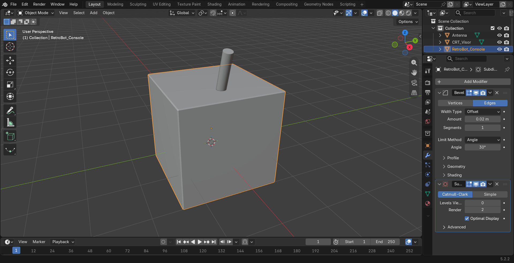
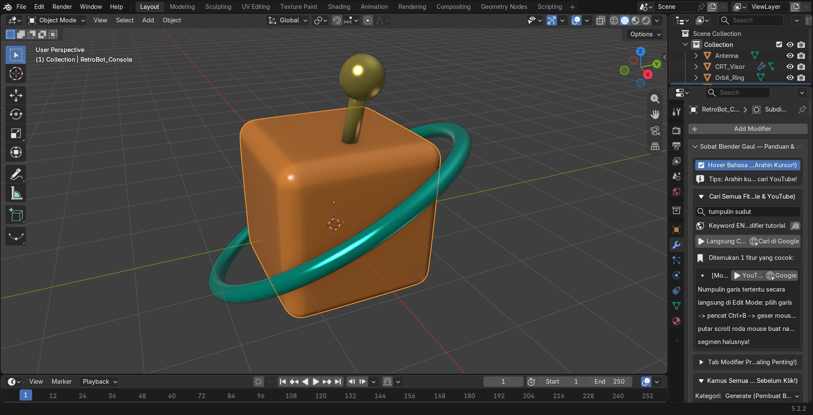
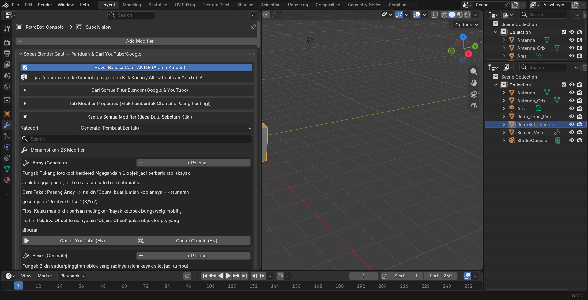
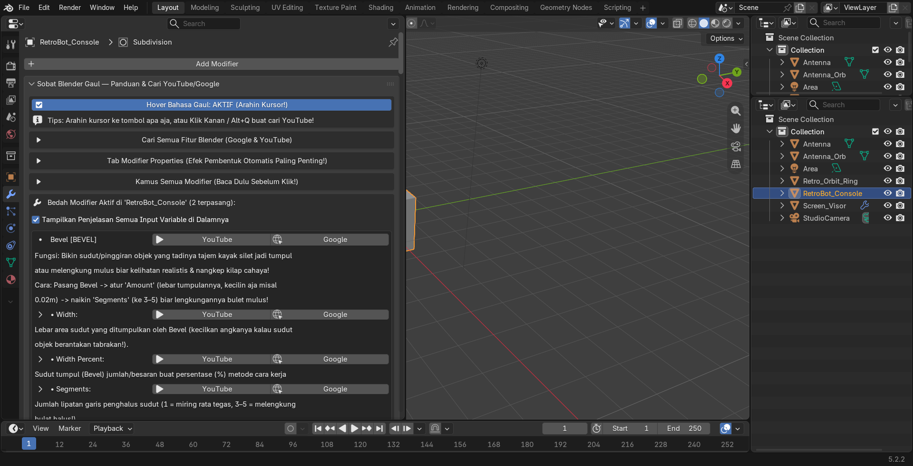
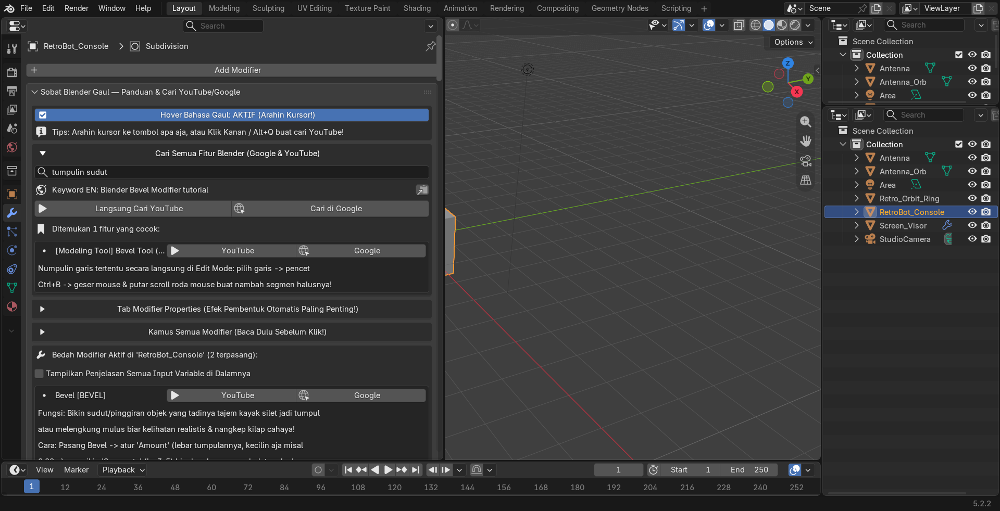
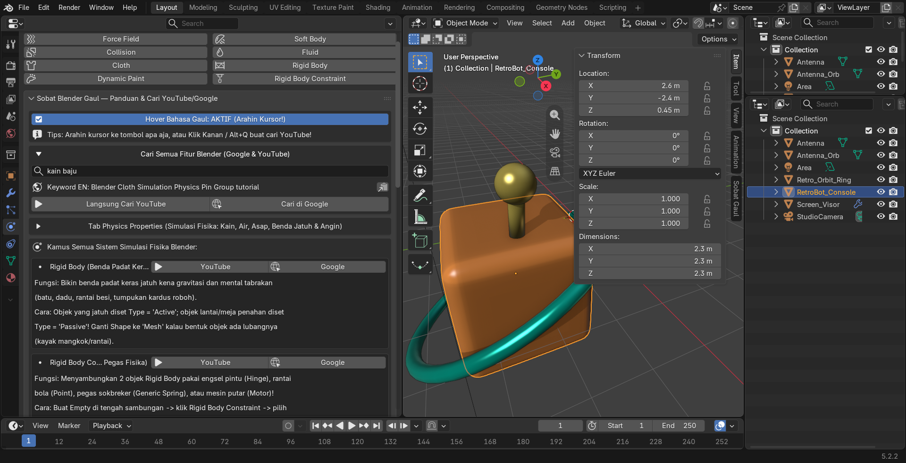

# ☕💖 OPEN DONASI / DUKUNG KREATOR DI SAWERIA!
### **[👉 KLIK DI SINI BUAT TRAKTIR KOPI: https://saweria.co/Luthfitegar 👈](https://saweria.co/Luthfitegar)**

> [!IMPORTANT]
> **☕ OPEN DONASI — DUKUNG BIAR MAKIN RAJIN BIKIN ADD-ON GRATIS!**  
> Add-on **Sobat Blender Gaul** ini gue bagikan **100% GRATIS** buat ngebantu temen-temen pemula 3D Indonesia biar gak pusing lagi belajar Blender! Kalau tool ini ngebantu belajar/kerjaan lu dan ada rezeki lebih buat traktir kopi, gas langsung mampir ke Saweria gue ya:  
> 👉 **Saweria:** **https://saweria.co/Luthfitegar**  
> 📸 **Instagram:** **[@Luthfitegar58](https://www.instagram.com/Luthfitegar58)** | 📧 **Email:** **Luthfitegar58@gmail.com**

---

# 🇮🇩 Sobat Blender Gaul — Kamus Properties & Cari Tutorial (Blender 4.2 – 5.2+)

> **Belajar Blender Tanpa Pusing!** Add-on / Extension Blender yang mengubah seluruh *hover tooltip* di **20 Tab Properties** & **83+ Modifier** menjadi penjelasan **Bahasa Indonesia Gaul yang ramah pemula** (`Fungsi` + `Cara Pakai` sebelum diklik!), lengkap dengan fitur **1-Klik Cari ke YouTube & Google menggunakan Keyword Bahasa Inggris otomatis**.

---

## ✨ Before vs After di Blender 5.2

| ❌ Before (Blender Polosan — Bikin Pemula Bingung) | ✅ After (Sobat Blender Gaul Aktif!) |
| :---: | :---: |
|  |  |

---

## 🔥 Fitur Utama

1. **Hover Tooltip Bahasa Gaul Otomatis (Muncul Sebelum Klik!)**
   - Arahkan kursor (*hover*) ke ikon tab Properties, menu `Add Modifier`, *slider* angka, *checkbox*, *dropdown*, maupun *input variable* mana pun — kotak *tooltip* bawaan Blender langsung menjelaskan **`Fungsi:`** dan **`Cara Pakai:`** dengan bahasa tongkrongan yang gampang dipahami pemula.
   - **Label UI tetap Bahasa Inggris asli** (`Bevel`, `Subdivision Surface`, `Roughness`, `Segments`) supaya kamu tetap nyambung saat menonton tutorial internasional!

2. **Menyeluruh 100% ke Seluruh 20 Tab Properties (13.052+ Fitur & Input Variable)**
   - Mencakup **seluruh 20 Tab Properties** sampe ke akar-akarnya: `Active Tool`, `Render` (`EEVEE`, `Cycles`, `Workbench`), `Output`, `View Layer`, `Scene`, `World`, `Collection`, `Object`, `Modifiers` (**83 Modifier bawaan + Hair & Geometry Nodes Assets Blender 5.2**), `Particles`, `Physics`, `Constraints` (**29 Constraints**), `Object Data` (**16 tipe objek**: Mesh, Camera, Light, Curve, Hair, Armature, Grease Pencil, Text, dll.), `Bone`, `Bone Constraints`, `Material` (seluruh *socket* `Principled BSDF`), `Texture`, `Visual Effects`, `Strip`, dan `Strip Modifiers`.

3. **Klik Kanan & Shortcut `Alt + Q` -> Langsung Cari YouTube & Google (Keyword Inggris!)**
   - Masih bingung? **Klik Kanan** di tombol/angka **mana pun di seluruh Blender** (atau tekan **`Alt + Q`** saat *hover*) untuk membuka **Kartu Pintar Sobat Blender Gaul** dan langsung mencari video tutorial di **YouTube** atau penjelasan di **Google** menggunakan *keyword* Bahasa Inggris yang otomatis dirangkai sesuai konteks tombol tersebut!

4. **Pencari Pintar Bahasa Sehari-hari -> Keyword Bahasa Inggris**
   - Ketik pakai bahasa sehari-hari di kotak pencarian panel (contoh: *"tumpulin sudut"*, *"bolongin objek"*, *"kain baju"*, *"kamera blur bokeh"*) — add-on otomatis menerjemahkannya ke istilah resmi Bahasa Inggris Blender (`"Blender Bevel Modifier tutorial"`) dan siap membuka YouTube / Google!

---

## 📸 Cuplikan Tampilan di Dalam Blender 5.2

| Kamus Modifier Sebelum Klik | Bedah Semua Input Variable Aktif |
| :---: | :---: |
|  |  |

| Pencarian Indo -> Keyword Inggris | Tab Physics & Sidebar N-Panel `Sobat Gaul` |
| :---: | :---: |
|  |  |

---

## 🚀 Cara Install (Blender 4.2 — 5.2+)

1. Download file siap pasang **[`sobat_blender_gaul-1.0.0.zip`](sobat_blender_gaul-1.0.0.zip)** dari repository ini.
2. Buka **Blender** -> masuk ke menu **Edit -> Preferences**.
3. Pilih tab **Get Extensions** (atau **Add-ons**) -> klik ikon panah kecil di pojok kanan atas `⌄` -> klik **Install from Disk...**
4. Pilih file `sobat_blender_gaul-1.0.0.zip`, lalu pastikan tercentang aktif. Mode Hover Bahasa Gaul langsung otomatis menyala!

---

## 🎬 Web Motion Graphic Promo (60fps JavaScript + WebAudio Synth)

Cek juga animasi promosi interaktif bergaya **Modern-Retro Motion Graphic** secara live di **[https://tegarmedia.github.io/sobat-blender-gaul/](https://tegarmedia.github.io/sobat-blender-gaul/)** (atau di dalam folder [`docs/index.html`](docs/index.html)).

---

## ☕ Support & Kontak

- 💖 **Open Donasi Saweria:** [https://saweria.co/Luthfitegar](https://saweria.co/Luthfitegar)
- 📸 **Instagram:** [@Luthfitegar58](https://www.instagram.com/Luthfitegar58)
- 📧 **Email:** Luthfitegar58@gmail.com

## 📜 Lisensi

Dirilis di bawah lisensi **GPL-3.0-or-later** (sesuai standar resmi Blender Extensions).
